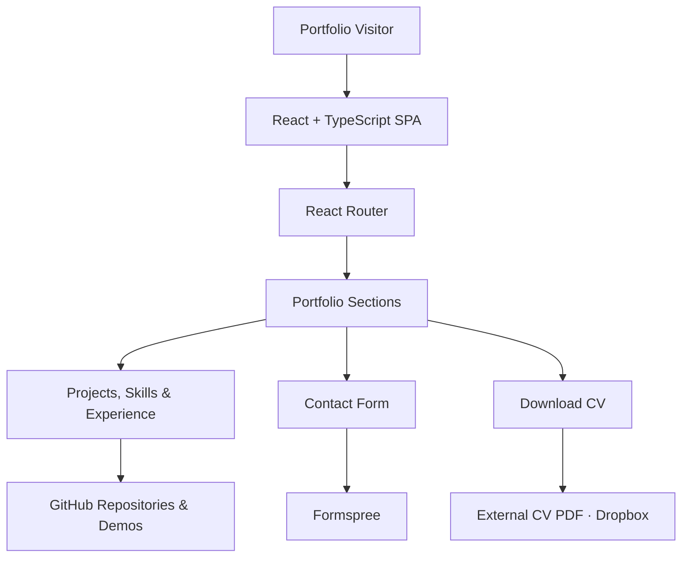
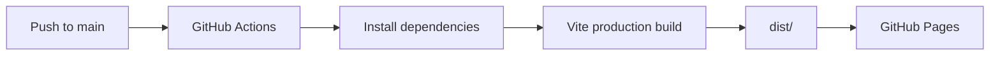

<div align="center">


# PortfolioKS

**A developer portfolio showcasing software projects, technical skills, and experience through an interactive, terminal-inspired interface.**

<p>
  <a href="https://avuii.github.io/PortfolioKS/">
    
  </a>
  <a href="https://github.com/Avuii/PortfolioKS/actions/workflows/deploy.yml">
    
  </a>
</p>

<p>
  
  
  
  
  
</p>

**[Live Portfolio](https://avuii.github.io/PortfolioKS/)** · **[Source Code](https://github.com/Avuii/PortfolioKS)** · **[Report an Issue](https://github.com/Avuii/PortfolioKS/issues)**

</div>

---

## Application Preview

<p align="center">
  <a href="https://avuii.github.io/PortfolioKS/">
    <strong>Open the Interactive Portfolio →</strong>
  </a>
</p>

The live website is the interactive preview. It uses a GitHub Dark-inspired visual language, terminal-style panels, animated content, and navigation adapted to desktop and mobile screens.

| Portfolio Area | What Visitors Can Explore |
| --- | --- |
| **Home** | Developer introduction, technology highlights, animated code and CV access |
| **About** | Background, education, development focus and current work |
| **Skills** | Technical skill groups and related project references |
| **Experience** | Professional experience and technical responsibilities |
| **Projects** | Featured applications, repository links and available demos |
| **Why Work With Me** | Development approach and engineering strengths |
| **Contact** | Contact details, profile links and a message form |

## Table of Contents

- [Overview](#overview)
- [Key Features](#key-features)
- [Technology Stack](#technology-stack)
- [Architecture](#architecture)
- [Getting Started](#getting-started)
- [Configuration & External Integrations](#configuration--external-integrations)
- [Testing & Security](#testing--security)
- [Project Status & Roadmap](#project-status--roadmap)
- [License](#license)
- [Author](#author)

## Overview

**PortfolioKS** is the personal software development portfolio of Katarzyna Stańczyk. It presents projects and experience across **C#/.NET, backend engineering, full-stack development, databases, DevOps and related technical areas**.

Rather than functioning as a static résumé page, the site combines a structured project showcase with developer-oriented interface elements: code-like typography, interactive technical sections, contextual navigation, and subtle animations. The portfolio is available in **English and Polish**.

The website is a **client-side React application**. It does not require a custom backend or database to display portfolio content.

## Key Features

| Feature | Description |
| --- | --- |
| **Bilingual interface** | Switch between English and Polish directly in the header. |
| **Interactive project showcase** | Browse featured projects, technology tags, source repositories and available live demos. |
| **Technical skills explorer** | Review grouped skills and links to projects in which the technologies are used. |
| **Experience & background** | Explore professional experience, education, current focus and development approach. |
| **Responsive navigation** | Section-aware navigation rail on desktop and bottom navigation on smaller screens. |
| **Terminal-inspired design** | Animated code, developer-themed panels, a custom cursor for pointer devices and grid backgrounds. |
| **Motion & sound controls** | UI animations and an optional click-sound toggle. |
| **CV access** | Open the current CV PDF through the external download link. |
| **Contact form** | Send a message using the Formspree integration, with basic field validation and submission feedback. |

> [!NOTE]
> Featured project metadata, including displayed star and fork counts, is currently defined in the source code rather than fetched live from GitHub.

## Technology Stack

| Area | Technologies |
| --- | --- |
| **Frontend** | React 18, TypeScript |
| **Build tooling** | Vite 6, npm |
| **Styling** | Tailwind CSS 4, custom CSS variables |
| **UI components & icons** | Radix UI, Material UI dependencies, Lucide React |
| **Animation** | Motion |
| **Routing** | React Router |
| **Contact** | Formspree |
| **Hosting & delivery** | GitHub Pages, GitHub Actions |

The repository includes additional UI packages in `package.json`; the table focuses on the principal technologies used to build and present the portfolio.

## Architecture

PortfolioKS is deployed as a static single-page application. Portfolio content is rendered through React components, while outbound links and the contact form communicate with external services.



### Repository Structure

```text
PortfolioKS/
├── .github/
│   └── workflows/
│       └── deploy.yml          # GitHub Pages workflow
├── src/
│   ├── app/
│   │   ├── components/        # Portfolio sections and interface components
│   │   ├── App.tsx            # Router provider
│   │   ├── Root.tsx           # Page composition and shared UI state
│   │   └── routes.ts          # Route configuration
│   ├── imports/               # Images and imported assets
│   ├── styles/                # Global styles, fonts and theme
│   └── main.tsx               # React entry point
├── index.html
├── package.json
├── package-lock.json
├── tsconfig.json
└── vite.config.ts
```

### Deployment Flow



## Getting Started

### Prerequisites

- **Node.js 24** (used by the deployment workflow)
- **npm**
- **Git**

### Installation

Clone the repository and install its dependencies:

```bash
git clone https://github.com/Avuii/PortfolioKS.git
cd PortfolioKS
npm ci
```

### Run Locally

```bash
npm run dev
```

Open the local URL printed by Vite. The project uses the `/PortfolioKS/` base path; with the default Vite port, the local address is typically `http://localhost:5173/PortfolioKS/`.

### Production Build

```bash
npm run build
npm run preview
```

The production build is generated in `dist/`. Use the address printed by `npm run preview` to inspect the built site.

> [!TIP]
> No Docker container, backend server or local database is required to run the portfolio.

## Configuration & External Integrations

### Project Configuration

| File / Location | Purpose |
| --- | --- |
| `vite.config.ts` | Vite plugins, import aliases and the `/PortfolioKS/` deployment base path |
| `src/app/Root.tsx` | Main page sections, language state and sound toggle |
| `src/app/components/projects.tsx` | Featured projects, repository references and displayed metadata |
| `src/app/components/skills.tsx` | Skill categories and project associations |
| `src/app/components/contact.tsx` | Contact form and Formspree endpoint |
| `src/app/components/hero.tsx` | Introductory content and external CV download |
| `src/styles/theme.css` | Theme palette and shared design tokens |

### External Services

| Integration | Usage | Notes |
| --- | --- | --- |
| **GitHub Pages** | Static hosting | Deployments are configured for the `/PortfolioKS/` repository path. |
| **GitHub** | Links to project repositories | Featured repository statistics in the UI are currently static values. |
| **Formspree** | Contact form submissions | Messages are sent from the visitor's browser to the configured Formspree endpoint. |
| **Dropbox** | CV download | The download button opens an externally hosted PDF. |

> [!IMPORTANT]
> This is a public frontend application. Never place private API keys, access tokens or passwords in source files or Vite variables intended for client-side use. Browser-delivered code and configuration are visible to visitors.

## Testing & Security

### Build Validation

Run the production build before committing changes:

```bash
npm ci
npm run build
```

The [GitHub Pages workflow](.github/workflows/deploy.yml) installs dependencies, builds the site and deploys the generated `dist/` directory when changes are pushed to `main`. It can also be started manually from GitHub Actions.

The current `package.json` does **not** define automated unit-test, end-to-end-test or lint scripts. A successful deployment therefore confirms that the production build completes, not that browser interactions have been tested automatically.

### Data & Security Notes

- The site is delivered as a static client application, without a custom authentication system or backend database.
- The contact form sends the visitor-provided name, email address and message to **Formspree**, an external service.
- CV downloads and project links open third-party destinations.
- No local secrets are required to build the current site.

> [!WARNING]
> Do not treat client-side validation as a security boundary. Contact-form abuse prevention and submission processing depend on the configured external form service.

## Project Status & Roadmap

**Status:** Deployed and available on GitHub Pages. The following checklist reflects the functionality present in the repository.

### Implemented

- [x] React and TypeScript single-page application
- [x] Responsive layout with desktop and mobile navigation
- [x] English and Polish interface
- [x] About, skills, experience, projects and contact sections
- [x] Featured project cards and repository links
- [x] Animated terminal-inspired UI and custom cursor
- [x] Optional interface click sounds
- [x] External CV download
- [x] Formspree contact form with submission feedback
- [x] Automated production build and GitHub Pages deployment

### Potential Improvements

- [ ] Add automated component and end-to-end tests for the main visitor flows.
- [ ] Add accessibility checks and verify keyboard and reduced-motion behavior across the site.
- [ ] Replace manually maintained repository statistics with verified live data or remove the counters.
- [ ] Add versioned interface screenshots to the repository documentation.
- [ ] Extend build checks with dedicated linting and type-checking commands.

## License


---

## Author

Created and maintained by **[Avuii](https://github.com/Avuii)**.
